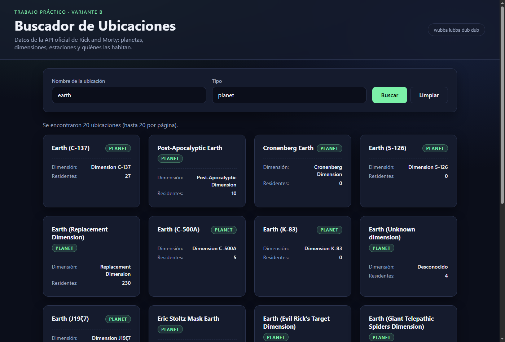

# TP · Buscador de Ubicaciones — Rick and Morty

**Autor:** Fede González
**Variante:** B · Ubicaciones (último dígito de cédula: 5)

## Descripción

Página web de una sola pantalla que busca datos de la [API de Rick and Morty](https://rickandmortyapi.com/documentation) y los muestra en tarjetas. Corresponde a la **variante B**: se consultan las **ubicaciones** del universo de la serie, combinando un **filtro de nombre** con un **filtro de tipo** (por ejemplo `Planet`) en una sola petición.

Cada tarjeta muestra:

- **Nombre** de la ubicación
- **Tipo** (Planet, Space station, etc.)
- **Dimensión**
- **Cantidad de residentes** (`residents.length`)

Los datos vacíos o `"unknown"` se muestran como **«Desconocido»**, y una búsqueda sin coincidencias (404 de la API) se informa como **«Sin resultados»**, no como un error.

## Cómo se usa

1. Escribí un **nombre** (ej.: `Earth`) o un **tipo** (ej.: `Planet`) — o ambos.
2. Presioná **Buscar**. Los criterios se combinan en la misma petición: `https://rickandmortyapi.com/api/location?name=earth&type=planet`
3. La última búsqueda queda guardada en `localStorage` y se repite sola al recargar la página.
4. **Limpiar** borra los campos, los resultados y la búsqueda guardada.

## Requisitos implementados

| N.º | Requisito | Dónde está |
|-----|-----------|------------|
| R1 | HTML semántico (`header`, `main`, `footer`, `form` con `label`, `lang="es"`, `title`) | `index.html` |
| R2 | Grid con `repeat(auto-fill, minmax(...))` y Flexbox en encabezado/formulario | `css/estilos.css` |
| R3 | +8 variables CSS en `:root`, responsive sin desplazamiento horizontal a 375 px | `css/estilos.css` |
| R4 | `async/await`, `new URL()` + `searchParams`, `await respuesta.json()` | `js/app.js` → `construirUrl`, `pedirUbicaciones` |
| R5 | Nombre y tipo combinados en una sola petición, `preventDefault`, aviso sin criterios | `js/app.js` → `manejarEnvio` |
| R6 | Tarjetas con `createElement` y `textContent` (sin `innerHTML`), «Desconocido» | `js/app.js` → `crearTarjeta` |
| R7 | «Buscando…», botón desactivado, mensajes de 404 y de error, `finally` | `js/app.js` → `realizarBusqueda` |
| R8 | Persistencia de nombre y filtro en `localStorage` con búsqueda automática al cargar | `js/app.js` → `guardarBusqueda` / `iniciar` |
| R9 | `const`/`let`, arrow functions, funciones de una sola tarea, consola sin errores | `js/app.js` |
| R10 | Publicación en GitHub Pages y este README | repositorio |

## Estructura

```
tp-gonzalez-fede/
├── index.html
├── README.md
├── css/
│   └── estilos.css
├── js/
│   └── app.js
└── img/
    └── captura.png
```

## Captura de pantalla



## Tecnologías

HTML semántico, CSS (Flexbox, Grid, variables, responsive), JavaScript ES6+, `fetch` con `async/await`, `localStorage` y despliegue con GitHub Pages.
